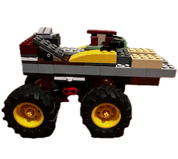

# Rover

A side-scrolling rover prototype with horizontal movement, a scrolling background and repeated jump boosts. Obstacles, scoring and objectives are planned.

## Gameplay

### Movement

* Left and Right arrow keys to move
* Spacebar to jump; press again in midair for another boost
* Equals/plus or minus to adjust nominal speed (0 pauses)
* D toggle diagnostics
* F toggle fullscreen
* Q quit
* Resize the window to change the viewport

## Command line options

* `-speed N` Set the general game speed 0 - 60 (0 pauses; the historical tick scheduler makes the rate approximate). Default is 30.
* `-debug` Print some debug information to the screen and the console.
* `-width N` Set the width of the screen. Default is 800.
* `-height N` Set the height of the screen. Default is 600.

## Graphics

Graphics by Matt. Nathan created the Lego builds that were used for the assets.



## TODO

* Implement max jump height
  * fuel that runs out and requires recharge with item pickup or time
* Graphics
  * ~~fire rockets on jump~~
  * ~~flip vehicle direction~~
  * ~~scale background~~
* Obstacles
* Score
* Objective of the game?

## Build and dependency verification

Requires Go 1.27.3 or newer. Go's automatic toolchain selection can download the version declared in `go.mod`.

```sh
go mod download
go mod verify
go vet ./...
go test ./...
go build -o build/game .
```

Ebitengine's native Linux build requires its graphics development libraries and a display to run. See the [Ebitengine installation guide](https://ebitengine.org/en/documents/install.html).

A WebAssembly compilation check is also available:

```sh
GOOS=js GOARCH=wasm go build -o build/game.wasm .
```

In PowerShell, set `$env:GOOS = "js"` and `$env:GOARCH = "wasm"` before the build, then remove those environment variables afterward. This is the lower-level compilation check; the complete browser launcher is built with the command below. Deterministic simulation tests run without a display. See [testing and manual checks](docs/TESTING.md), [project specification](docs/PROJECT_SPEC.md), [coding standards](docs/CODING_STANDARDS.md), and [agent workflow](AGENTS.md).

Run the desktop app with `go run .`, or for example `go run . -width 1024 -height 768 -speed 30`. Startup dimensions must be 1..8192 pixels and speed must be 0..60; invalid settings fail with an error before asset/window initialization.

## Browser version

With Node 24+ installed, run `npm ci --ignore-scripts`, then `go run ./cmd/web -serve -port 8080` and open [localhost:8080](http://localhost:8080/). The game starts immediately; every command-line setting is also available on the page. Apply / restart creates a fresh run. Arrow keys / Space and on-screen buttons control the rover.

The browser launcher, Go/Wasm input/loading bridge and page styles come from [web-shared](https://github.com/Warsinger/web-shared). The exact shared revision and integrity hash are locked in `package-lock.json` and bundled locally with the app. Rover retains its settings, controls, content and colors. Native builds do not require Node or this browser dependency.

The deployment target is [rovergo.pages.dev](https://rovergo.pages.dev/). See [browser behavior](docs/BROWSER.md) and [deployment/preview instructions](docs/DEPLOYMENT.md). See [application icons](docs/ICONS.md) for artwork, regeneration and desktop support.
